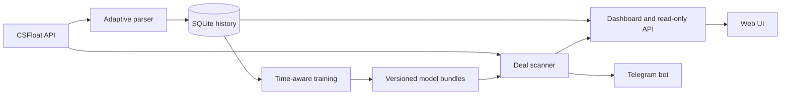

# CS2 Market Analytics

[](https://github.com/AlmazAlmaz/cs2-market-analytics/actions/workflows/ci.yml)

Production-oriented система аналитики рынка CS2: она собирает историю продаж
CSFloat в SQLite, ищет активные сделки, оценивает их тремя независимыми ML-моделями,
показывает результаты в web-интерфейсе и при необходимости отправляет их в
Telegram.

Репозиторий показывает полный исходный код, тесты и воспроизводимые отчёты о
моделях. Рабочая база, API-ключи, пользовательские данные и обученные веса
намеренно исключены из Git.

## Что здесь реализовано

- адаптивный parser с cursor pagination, дедупликацией, карантином повреждённых
  записей, атомарным статусом и single-instance lock;
- три независимых price-модели: gradient boosting Almaz и Igor, residual neural
  network Nova с квантилями q15/q50/q85;
- хронологические train/validation/test split и отдельный quality gate перед
  атомарной активацией новой версии модели;
- scanner активных лотов с консервативным consensus, ROI, liquidity и freshness;
- двуязычный dashboard, аккаунты, inventory, рыночные тренды и read-only export API;
- защита секретов, HttpOnly/SameSite cookies, default-deny Telegram access и
  безопасная работа с SQLite snapshots.

## Архитектура



Основные entry points: `parser_final.py`, `dashboard_server.py`, `deal_scanner.py`,
`trend_worker.py`, `model_training_jobs.py` и `start_all.sh`. Модельные runtime
находятся в `price_model_runtime.py`, `igor_model_runtime.py` и
`neural_model_runtime.py`.

## Проверенные результаты

| Модель | Chronological holdout | MAE | Median APE |
|---|---:|---:|---:|
| Almaz v3 | 51 802 | $1.63 | 5.65% |
| Igor v2 | 1 105 новых продаж | $0.96 | 4.92% |
| Nova | 142 678 | $1.53 | 5.15% |

Размеры и временные границы holdout различаются, поэтому строки не являются
прямым рейтингом моделей. Методика и ограничения описаны в
`MODEL_UPDATE_REPORT.md`, `IGOR_UPDATE_REPORT.md` и `NEURALMODEL/README.md`.

## Проверка из свежего clone

Нужен Python 3.12. Установка зависимостей включает PyTorch и CatBoost.

```bash
git clone https://github.com/AlmazAlmaz/cs2-market-analytics.git
cd cs2-market-analytics
python3.12 -m venv .venv
./.venv/bin/python -m pip install -r requirements-dev.txt
./.venv/bin/python -m pytest
./.venv/bin/ruff check --select E4,E7,E9,F --ignore E402,E731 .
```

Текущий набор содержит 880 тестов. CI выполняет эти же проверки на Python 3.12.

## Полный локальный запуск

`setup_mac.sh` создаёт окружение и приватные шаблоны конфигурации:

```bash
./setup_mac.sh
```

Полная система требует локальную историю SQLite и обученные model bundles. Эти
файлы велики, зависят от приватных данных и не публикуются. На уже подготовленной
машине все процессы запускаются одной командой:

```bash
./start_all.sh
```

Команда запускает dashboard, parser, scanner, Trend worker и настроенный reverse
SSH до VPS, проверяет локальный и публичный `/health` и корректно завершает
дочерние процессы по `Ctrl+C`. Необязательные Telegram и export API включаются
только при заполненной конфигурации.

## Основные разделы сайта

После входа верхнее меню одинаково на всех пользовательских страницах:

- `Сделки` / `Deals` — найденные активные предложения и фильтры выгоды;
- `Проверить лот` / `Check listing` — одна форма сравнения Almaz, Igor и Nova;
- `Стратегия` / `Strategy` — тренды, ликвидные скины до $10, коллекции и подбор
  по размеру банка;
- `Рынок` / `Market` — общий каталог скинов, перчаток и наклеек; ножи и история
  цен доступны из дополнительного меню этого раздела;
- `Инвентарь` / `Inventory` — личные покупки, выставленные и проданные позиции.

У администратора дополнительно появляется `Система` / `System`. Там находятся
управление scanner, состояние parser и моделей, переобучение, диагностика и
просмотр базы. Обычным аккаунтам эти служебные функции не показываются.

Отдельного пункта Nova больше нет: ручная проверка в `Проверить лот` сразу
показывает все три модели. Старый адрес `/neural` сохранён как совместимый
redirect на `/deal`. Сама Nova, её обучение и API `/api/predict-neural` и
`/api/neural-status` продолжают работать.

Пробный запуск только сайта, без API-запросов и VPS:

```bash
START_PARSER=0 START_SCANNER=0 START_TREND=0 START_REVERSE_TUNNEL=0 START_API=0 START_TELEGRAM=0 ./start_all.sh
```

Оставь терминал открытым. `Ctrl+C` корректно остановит процессы, которые запустила
команда. Логи находятся в `logs/`.

## Parser v2

Парсер истории теперь планирует запросы по фактической скорости продаж и
перекрытию с уже сохранёнными ID. Цель по умолчанию — около 20 новых продаж на
запрос, а при полном окне без перекрытия интервал автоматически сокращается.
Если API когда-либо вернёт явный cursor, парсер пройдёт страницы до известной
продажи; обычный ответ-список не принимается за бесконечно пагинируемый.

Повторно увиденная продажа больше не переписывает исходный снимок и `fetched_at`:
обновляются только `last_seen_at`, счётчик наблюдений и служебный hash. Поэтому
повторный fetch не стирает обогащение стикеров. Keychains/charms сохраняются в
отдельной таблице, а повреждённые элементы попадают в `parser_quarantine`.

Безопасные служебные команды:

```bash
# Только схема и перенос компактных полей, без запросов к CSFloat
./.venv/bin/python parser_final.py --migrate-only --backfill-derived

# Принудительно обновить локальный каталог скинов/ножей и очередь, но не историю CSFloat
./.venv/bin/python parser_final.py --refresh-catalog-only

# Не более одного уже запланированного запроса
./.venv/bin/python parser_final.py --once
```

Обычный запуск остаётся одной командой `./start_all.sh`. Второй экземпляр
`parser_final.py` не запустится благодаря lock-файлу, а SIGTERM/Ctrl+C записывают
в статус корректную остановку.

Остановка: `Control+C` в окне запуска либо `./stop_all.sh` из другого Terminal.
Скрипт останавливает супервизор, который затем корректно завершает все поднятые
им процессы и удаляет PID-файлы.

Каталог обновляется только фоновым парсером, а HTTP-запросы сайта читают уже
проверенный локальный снимок SQLite. Основной источник — точные варианты
`skins_not_grouped` из ByMykel/CSGO-API. Коллекции и кейсы безопасно дополняются
из grouped `skins.json` того же проекта по связи `skin_id → id`; grouped feed не
может добавить или переопределить точный market-вариант. Сохраняются тип
предмета, нож, покрытие, износ, paint index, Doppler-фазы, коллекции, кейсы и
изображение. Старые цели и накопленная статистика расписания при обновлении не
удаляются, а защита от резкого уменьшения общего каталога или отдельного типа
не даёт усечённому upstream-снимку заменить последний хороший. Лицензии и
атрибуция перечислены в `THIRD_PARTY_NOTICES.md` и дублируются в метаданных
каждого каталожного снимка без credentials/query-параметров source URL.

## Ножи и перчатки

Страница `/knives` отделена от оружейных скинов. Она показывает каталог,
фильтры по типу/покрытию/фазе/износу/коллекции или кейсу, наблюдаемую
ликвидность, график продаж и отдельный блок недавно замеченных выгодных
CSFloat-лотов. Значения за 7/30 дней — прошлое движение цены, а не обещание
доходности; наличие конкретного лота всегда нужно перепроверять перед покупкой.

Ножи не передаются Almaz, Igor или Nova. Для них предусмотрены отдельные
артефакты `KNIFEMODEL` и отдельный quality gate. До накопления как минимум
16 000 продаж с воспроизводимыми на момент продажи reference-полями кнопка
обучения остаётся заблокированной, а сайт честно работает только по истории.
В локальном `deal_scanner_config.json` малый knife-профиль уже включён, но до
активации проверенной отдельной модели он fail-closed и не делает сетевых
запросов. После активации scanner ограничен одной целью, десятью лотами и одной
страницей за цикл по умолчанию. Сохраняемый курсор последовательно обходит весь
каталог ножей и переживает перезапуск процесса.

Перчатки изолированы тем же способом в `GLOVEMODEL`: отдельные staging,
immutable generation, runtime-slot и quality gate. Almaz, Igor и Nova обучаются
только на строках `item_kind=weapon_skin`; ножевые и перчаточные строки не
попадают в их cache, fingerprint, eligibility или runtime-маршрут. Если для
перчаток пока не накоплены 16 000 time-safe продаж, карточка модели показывает
точный недостающий объём и scanner не делает сетевые запросы вместо подмены
моделью оружия или ножей.

`deal_scanner.py` защищён отдельным lock-файлом по той же причине: случайный
ручной запуск поверх `./start_all.sh` не создаст второй поток платных/лимитируемых
запросов и конкурирующего writer в SQLite.

## Управление поиском выгодных скинов

На сайте под учётной записью администратора открой `Система` и блок управления
scanner. Там можно отдельно приостановить или включить поиск активных выгодных
лотов и изменить интервал от
1 минуты до 24 часов. Исходный интервал — 10 минут; изменение подхватывается
живым процессом без перезапуска `start_all.sh`.

Интервал считается между началами циклов. Пауза не обрывает уже выполняющийся
HTTP-запрос посередине, но не разрешает начинать следующий запрос или следующий
вызов модели. Это управление не останавливает `parser_final.py`: история продаж
продолжает собираться независимо.

Желаемые настройки и фактический heartbeat процесса хранятся раздельно в
локальных `deal_scanner_control.json` и `deal_scanner_status.json`. Сайт поэтому
отличает «поиск включён» от «процесс действительно запущен» и подскажет запустить
`./start_all.sh`, если scanner выключен на уровне процесса.

Для ручной проверки лота открой пункт `Проверить лот`: Almaz, Igor и Nova показаны
рядом. Главные цифры берутся из самой низкой доступной оценки, а согласие,
расхождение и временно недоступная модель обозначаются явно. Старый адрес
`/neural` перенаправляет на эту общую форму и не является отдельной вкладкой.

В `Проверке лота` можно задать независимые пороги минимального ROI, прибыли,
ликвидности и стоимости стикеров, а также максимальный float. Для объединённой
оценки применяются консервативные значения моделей: лот не проходит порог, если
его подтверждает только самая оптимистичная модель.

Кроме целевых стикеров scanner небольшими порциями проверяет ликвидные скины до
$10. Источник лота сохраняется отдельно, поэтому одна находка может одновременно
относиться к sticker- и liquid-поиску без повторного запуска моделей. Жёсткий
предел цены, объём цикла и минимальную скорость продаж можно изменить в
`deal_scanner_config.json`. Вкладка `Ликвидные до $10` показывает рыночные
кандидаты всегда, а реальные предложения на покупку — только когда scanner
работает и видел активный лот недавно.

## Переобучение моделей с сайта

В админском разделе `Система`, в блоке состояния моделей, показаны пять
изолированных карточек: Almaz, Igor и Nova для оружейных скинов, Knives для
ножей и Gloves для перчаток. Кнопка `Переобучить` становится доступна только
если одновременно накопилось не меньше 25 000 новых валидных продаж, рост базы
составил не меньше 5%, а после границы старой модели есть минимум 5 000
time-safe строк. Это полное переобучение на расширенной истории, а не
небезопасное продолжение старых весов.

Во время работы карточка показывает пять понятных стадий (данные, признаки,
обучение, сравнение, установка), процент, примерное оставшееся время и последние
строки журнала. После общего holdout-теста раскрывается таблица рабочей и новой
версии: median/mean/P90 APE, MAE в долларах, RMSE, R², покрытие интервала,
пересечение квантилей и доля строк, где кандидат точнее. Каждая строка явно
помечается как лучше, хуже или без изменения. Ошибка целостности/SHA отделена от
настоящего отклонения по качеству. Одновременно обучается только одна модель;
процесс можно отменить. Перед обучением создаётся отдельный согласованный
SQLite-снимок, поэтому parser и scanner могут продолжать работу и не меняют
выборку посередине прогона.

Перед стартом проверяется свободное место: минимум 6 GiB для Almaz, Knives и
Gloves, 12 GiB для Igor и 7 GiB для Nova. Для Igor желательно 16 GiB оперативной памяти;
одновременный запуск второго обучения всё равно заблокирован.

Результат всегда пишется в уникальный staging-каталог и сравнивается с текущей
активной моделью на одинаковых 5 000 самых новых отложенных продажах. Если
основные метрики не стали лучше либо interval/артефакты не прошли проверку,
кандидат отклоняется и рабочая модель не меняется. Успешный кандидат повторно
проверяется по hash, копируется в неизменяемую content-addressed версию,
загружается и проходит пробный runtime-прогноз. После этого один атомарный
указатель переключает новые запросы на модель без перезапуска сайта и scanner.

Запрос, который уже начал считать цену, спокойно заканчивает работу на старом
объекте. Если новый bundle не загрузился в одном из процессов, указатель
compare-and-swap откатывается на предыдущую проверенную версию; повреждённая или
подменённая версия не используется. Для следующего переобучения baseline всегда
берётся из текущей активной версии, а не из старых bootstrap-файлов. Хранятся
активная и предыдущая поколения, staging и снимки базы очищаются с безопасными
ограничениями. Старый offline activation в `./start_all.sh` оставлен только для
совместимости с уже созданными заданиями. Логи обучения находятся в
`logs/model_training/`, служебное состояние — в `.run/model_training/`. Не
выключай Mac во время обучения; при обычном `./start_all.sh` режим `caffeinate`
уже включён.

## Strategy: тренд, коллекции и подбор по банку

Страница `/strategy` собирает в одном месте предвычисленные прогнозы направления
рынка на 7/14/30 дней, диапазоны q15/q50/q85, вероятность роста, риск текущих
сделок, ожидаемый срок продажи и динамические веса Almaz/Igor/Nova. Дополнительные
вкладки дают:

- список ликвидных скинов до $10 с объёмом продаж, движением цены, прогнозом и
  свежими предложениями с необычным float или ценными стикерами;
- все известные коллекции, нормализованный индекс каждой коллекции, объём,
  долю растущих скинов, график отдельного скина и покрытие данных;
- подбор по размеру банка и цели: инвестиция, перепродажа float, перепродажа
  стикеров или сбалансированный режим.

При небольшом банке подбор ограничивает цену одной позиции примерно десятью
долларами; с ростом банка разрешает более дорогие позиции и сохраняет
диверсификацию. Инвестиционные идеи строятся по истории и прогнозам рынка, а
float/sticker-предложения требуют свежего активного лота. Это только аналитика:
страница не отправляет заявки и ничего не покупает.

Числа предложения подписаны по источнику. `Сделок в нашей БД` и `уникальных
asset ID` означают только наблюдения локального парсера, а количество листингов
из `ALL_SKINS.json` — приблизительный снимок рынка с датой обновления. Ни одно из
этих значений не выдаётся за точное количество предметов во всём мире.

Периоды графиков — календарные. Для коллекций состав торгующихся скинов по дням
может быть неполным, поэтому доходность и направление скрываются, если текущая
или сравниваемая точка покрывает меньше 20% состава. На самом графике индекса
такие точки тоже не рисуются; отдельный график coverage остаётся видимым, чтобы
причину пропуска можно было проверить.

`trend_worker.py` запускается вместе с `./start_all.sh`, работает с пониженным
приоритетом и обновляет отдельную `trend_market.db` примерно раз в шесть часов.
Во время переобучения модели тяжёлый Trend-цикл откладывается. Walk-forward
бэктест использует только прошлые данные и явно учитывает комиссию,
проскальзывание, вероятность исполнения, срок удержания, turnover и просадку.
Его отчёт заранее записывается worker-ом: HTTP-запрос сайта не запускает тяжёлый
пересчёт.

Scanner сохраняет версионные снимки рекомендаций и сверяет их только с продажей,
произошедшей после рекомендации. Пока подтверждённых исходов мало, вероятность
продажи и веса моделей честно помечаются как эвристические; после накопления
достаточной истории они переключаются на segment/family/global статистику.
Отключить только Trend worker можно так:

```bash
START_TREND=0 ./start_all.sh
```

Технический контракт и ограничения: [TRENDMODEL/README.md](TRENDMODEL/README.md).

## Аккаунты и личный инвентарь

Страницы `/register`, `/login` и `/account` используют отдельную базу
`.private/account_data.db`. Она не входит в экспорт истории CSFloat. В кабинете
можно записать цену и дату покупки, float/стикеры, выставленную цену, отметить
продажу, архивировать позицию и увидеть P&L после комиссии. Ориентир цены
подписан как исторический/model benchmark: это не live ask конкретного лота.

Для писем восстановления укажи публичный HTTPS-адрес и SMTP в
`config.local.env`:

```dotenv
CS2_ACCOUNT_PUBLIC_URL=https://csskinsprediction.online
CS2_ACCOUNT_COOKIE_SECURE=true
CS2_ACCOUNT_SMTP_HOST=smtp.example.com
CS2_ACCOUNT_SMTP_PORT=587
CS2_ACCOUNT_SMTP_FROM=no-reply@example.com
CS2_ACCOUNT_SMTP_USERNAME=no-reply@example.com
CS2_ACCOUNT_SMTP_PASSWORD=change-me
CS2_ACCOUNT_SMTP_SSL=false
CS2_ACCOUNT_SMTP_STARTTLS=true
```

На публичном домене не вводи пароли до включения HTTPS. Обычный аккаунт имеет
роль `member` и не может управлять scanner/model training или скачивать базу.
Если владелец регистрируется в браузере, где уже установлена admin-cookie от
`DASHBOARD_TOKEN`, аккаунт создаётся с ролью `admin`.

## Конфигурация и секреты

- `config.local.env` — локальные пути, токены приложения и настройки Telegram;
- `hosting.local.env` — только IP, SSH-пользователь и пароль/ключ VPS;
- оба файла уже исключены из Git и должны иметь права `0600`;
- примеры без секретов: `config.local.env.example` и
  `hosting.local.env.example`.

Не отправляй никому `.env`, файлы `key*`, `*_token.txt`, `*.db` и модельные
артефакты. Telegram-бот по умолчанию закрыт: для него нужно заполнить
`TELEGRAM_ALLOWED_CHAT_IDS` либо сознательно включить `TELEGRAM_ALLOW_ALL=true`.

## Nova Neural

Nova остаётся третьей отдельной моделью, но больше не занимает отдельный пункт
меню. Её результат показывается рядом с Almaz и Igor на странице `/deal`
(`Проверить лот`), а старый `/neural` перенаправляет туда же. Программные
контракты `/api/predict-neural` и `/api/neural-status` сохранены.

Одна residual-нейросеть с embeddings выдаёт упорядоченные квантили q15/q50/q85;
разбиение train/validation/test сделано по времени, а test не используется для
early stopping. Сохранённая модель занимает около 31 MB.

Рекомендуемый способ переобучения — кнопка модели в админском разделе
`Система`. Ручной запуск для разработки сохраняет только staging-кандидат:

```bash
./.venv/bin/python train_neural_model.py
```

Подробности: [NEURALMODEL/README.md](NEURALMODEL/README.md).

## Almaz v3

Almaz переобучена на 795 869 продажах с хронологическим untouched test,
runtime-safe признаками и интервалом q15–q85. На одинаковых 51 802 новых
продажах MAE снизилась с $2.3745 до $1.6276. Предыдущая production-модель
сохранена для отката.

Методика, сравнение и ограничения: [MODEL_UPDATE_REPORT.md](MODEL_UPDATE_REPORT.md).

## Igor v2

Igor переобучена на immutable snapshot из 806 677 продаж с единым
train/runtime-контрактом, time-safe reference-признаками, поддержкой keychains и
фиксированным хронологическим holdout. На независимой проверке из 1 105 новых
продаж MAE снизилась с $1.390 до $0.956, а Median APE — с 11.126% до 4.923%.
Предыдущая v1 сохранена для отката, новый bundle продвинут атомарно.

Raw q15–q85 coverage улучшился до 66.335%, но пока ниже номинальных 70%; малые
сегменты также требуют повторной проверки после накопления данных. Методика,
hashes, ограничения и точный rollback: [IGOR_UPDATE_REPORT.md](IGOR_UPDATE_REPORT.md).
Инструкция по следующему обучению: [IGORMODEL/README.md](IGORMODEL/README.md).

## Документация

- [Отчёт аудита и известные ограничения](AUDIT_REPORT.md)
- [Отчёт переобучения Almaz v3](MODEL_UPDATE_REPORT.md)
- [Отчёт переобучения Igor v2](IGOR_UPDATE_REPORT.md)
- [Архитектура и безопасное обучение Igor](IGORMODEL/README.md)
- [Установка и запуск на macOS](README_MAC.md)
- [Публикация через существующий VPS и reverse SSH](reverse_ssh_setup.md)
- [Архитектура и обучение Nova](NEURALMODEL/README.md)
